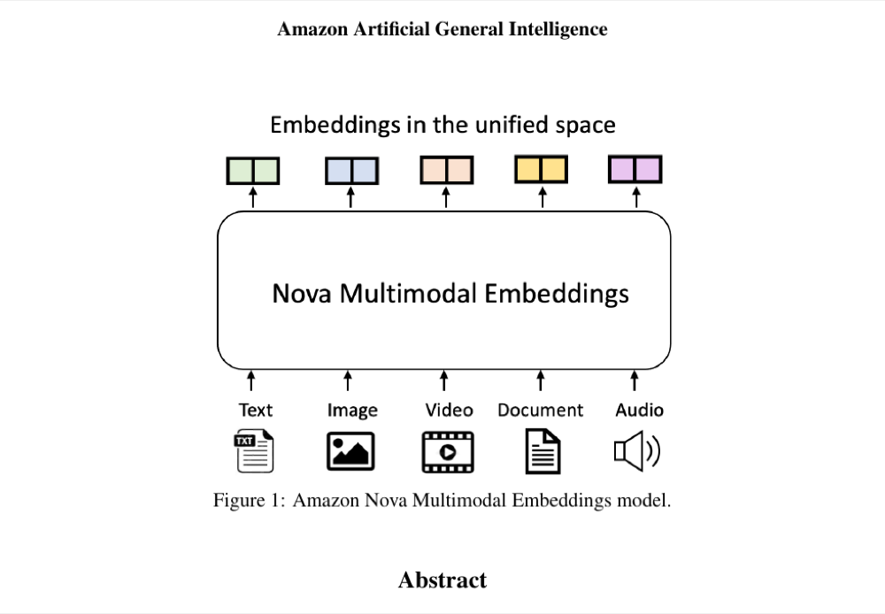

::: {.profile-page}

::: {.profile-header}
::: {.profile-identity}
# Vinay Varma

**Applied Scientist | Multimodal AI and Foundation Models**
:::

::: {.profile-links}
<a class="social-icon" href="https://github.com/vin136" aria-label="GitHub"><i class="bi bi-github"></i></a>
<a class="social-icon" href="https://www.linkedin.com/in/vinayvarma-k/" aria-label="LinkedIn"><i class="bi bi-linkedin"></i></a>
<a class="social-icon" href="https://x.com/vinnuvinay008" aria-label="X">X</a>
:::
:::

## About Me

::: {.about-grid}
::: {.portrait-wrap}
{.profile-portrait alt="Portrait of Vinay Varma"}
:::

::: {.about-copy}
I am an **Applied Scientist at Amazon Artificial General Intelligence**, where I work on multimodal foundation models and the large-scale training systems behind them. I am interested in building intelligent systems that can understand and reason across language, images, video, documents, audio, and other modalities.

I helped build **Amazon Nova Multimodal Embeddings** and contributed to the training infrastructure for the **Amazon Nova** family of models. Previously, I worked as a founding machine learning engineer on interactive AI assistants and on deep reinforcement learning for quantitative trading.

My broader interests include representation learning, distributed model training, multimodal retrieval, evaluation, and the systems needed to turn research into useful products.
:::
:::

## Experience

::: {.experience-list}
::: {.experience-item}
::: {.experience-meta}
### Amazon AGI
**Applied Scientist**

August 2024 - Present
:::

::: {.experience-details}
- Led engineering work for Amazon Nova Multimodal Embeddings, a unified model for agentic RAG and semantic search across five modalities.
- Built distributed data and training infrastructure for Amazon Nova foundation models, including topology-agnostic pipelines for elastic training.
- Developed evaluation and decision-making frameworks for multimodal training experiments across text, vision, and audio.
:::
:::

::: {.experience-item}
::: {.experience-meta}
### Vox AI
**Founding ML Engineer**

March 2024 - August 2024
:::

::: {.experience-details}
- Built low-latency conversational AI systems using fine-tuned language models, retrieval, and agentic workflows.
- Designed synthetic conversation generation and multi-round evaluation systems for tool use, long context, and regression testing.
- Optimized inference pipelines to reach human-speed conversational response times.
:::
:::

::: {.experience-item}
::: {.experience-meta}
### Charter Communications
**Data Scientist**

August 2023 - February 2024
:::

::: {.experience-details}
- Started the machine learning effort for device failure prediction on terabyte-scale operational data.
- Managed the end-to-end lifecycle across data pipelines, experimentation, deployment, and model monitoring.
:::
:::

::: {.experience-item}
::: {.experience-meta}
### Niveshi
**Machine Learning Engineer**

January 2018 - August 2021
:::

::: {.experience-details}
- Designed and deployed deep reinforcement learning systems for quantitative trading strategies.
- Developed uncertainty quantification methods to improve the robustness of trading signals.
- Built data, feature engineering, monitoring, and continual learning infrastructure for production models.
:::
:::
:::

## Selected Publications

::: {.publication-list}
::: {.publication-card}
::: {.publication-image-wrap}
{.publication-image alt="Diagram of Amazon Nova Multimodal Embeddings mapping five modalities into a unified embedding space"}
:::

::: {.publication-copy}
### Amazon Nova Multimodal Embeddings: Technical Report and Model Card

**Amazon Artificial General Intelligence** 
Amazon Technical Reports, 2025

Nova Multimodal Embeddings maps text, images, video, documents, and audio into a single embedding space for cross-modal retrieval, semantic search, and agentic RAG.

[Amazon Science](https://www.amazon.science/publications/amazon-nova-multimodal-embeddings-technical-report-and-model-card){.publication-link}
:::
:::

::: {.publication-card}
::: {.publication-image-wrap}
{.publication-image alt="Diagram of the Amazon Nova family of models"}
:::

::: {.publication-copy}
### The Amazon Nova Family of Models: Technical Report and Model Card

**Amazon Artificial General Intelligence** 
Amazon Technical Reports, 2024

The Amazon Nova family introduces multimodal and text foundation models designed for strong intelligence, speed, cost efficiency, and practical deployment on Amazon Bedrock.

[Amazon Science](https://www.amazon.science/publications/the-amazon-nova-family-of-models-technical-report-and-model-card){.publication-link}
:::
:::
:::

## Education

::: {.education-grid}
::: {.education-card}
### Rutgers University
**M.S. in Computer Science** 
2021 - 2023

Part-time lecturer for Machine Learning Principles and instructor for numerical analysis recitations.
:::

::: {.education-card}
### National Institute of Technology Delhi
**B.Tech. in Electronics and Communication Engineering** 
2014 - 2018
:::
:::

::: {.profile-footer}
I am always happy to connect with researchers and builders working on ambitious AI systems.

[LinkedIn](https://www.linkedin.com/in/vinayvarma-k/) · [GitHub](https://github.com/vin136) · [Blog](posts.html)
:::

:::
