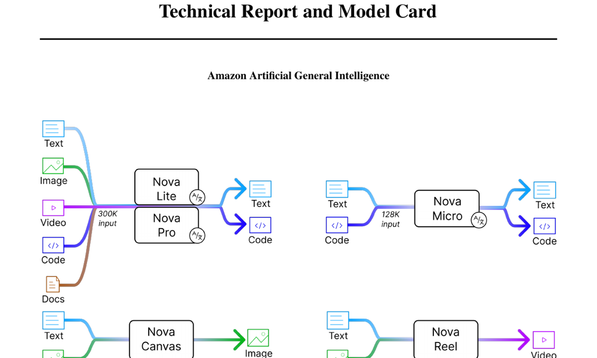

::: {.profile-page}

::: {.profile-header}
::: {.profile-identity}
# Vinay Varma

**Applied Scientist | Foundation Models**
:::

::: {.profile-links}
<a class="social-icon" href="https://github.com/vin136" aria-label="GitHub"><i class="bi bi-github"></i></a>
<a class="social-icon" href="https://www.linkedin.com/in/vinayvarma-k/" aria-label="LinkedIn"><i class="bi bi-linkedin"></i></a>
<a class="social-icon" href="https://x.com/vinnuvinay008" aria-label="X">X</a>
:::
:::

## About Me

::: {.about-grid}
::: {.portrait-wrap}
{.profile-portrait alt="Portrait of Vinay Varma"}
:::

::: {.about-copy}
I am an **Applied Scientist at Amazon Prime Video**, where I work on foundation models.

Previously, I was at **Amazon Artificial General Intelligence**, where I led research engineering for multimodal pre-training, post-training, and evaluation. I led the design, end-to-end training, and evaluation of **Amazon Nova Multimodal Embeddings**, and led research engineering for training and evaluating Nova vision encoders.

Earlier, I built low-latency conversational AI systems at Vox AI, device-failure prediction systems at Charter Communications, and production deep reinforcement learning systems for quantitative trading at Niveshi.
:::
:::

## Experience

::: {.experience-list}
::: {.experience-item}
::: {.experience-meta}
### Amazon Prime Video
**Applied Scientist**

May 2026 - Present
:::

::: {.experience-details}
- Build and evaluate foundation models for Prime Video.
:::
:::

::: {.experience-item}
::: {.experience-meta}
### Amazon AGI
**Applied Scientist**

August 2024 - May 2026
:::

::: {.experience-details}
- Research engineering lead for pre-training, post-training, and evaluation of [Amazon Nova multimodal models](https://aws.amazon.com/nova/models/), with a focus on scaling multimodal understanding.
- Led the design, end-to-end training, and evaluation of [Amazon Nova Multimodal Embeddings](https://aws.amazon.com/blogs/aws/amazon-nova-multimodal-embeddings-now-available-in-amazon-bedrock/).
- Led research engineering for training and evaluating Nova vision encoder models.
:::
:::

::: {.experience-item}
::: {.experience-meta}
### Vox AI
**Founding ML Engineer**

March 2024 - August 2024
:::

::: {.experience-details}
- Built low-latency conversational AI systems using fine-tuned language models, retrieval, and agentic workflows.
- Designed synthetic conversation generation and multi-round evaluation systems for tool use, long context, and regression testing.
- Optimized inference pipelines to reach human-speed conversational response times.
:::
:::

::: {.experience-item}
::: {.experience-meta}
### Charter Communications
**Data Scientist**

August 2023 - February 2024
:::

::: {.experience-details}
- Started the machine learning effort for device failure prediction on terabyte-scale operational data.
- Managed the end-to-end lifecycle across data pipelines, experimentation, deployment, and model monitoring.
:::
:::

::: {.experience-item}
::: {.experience-meta}
### Niveshi
**Machine Learning Engineer**

January 2018 - August 2021
:::

::: {.experience-details}
- Designed and deployed deep reinforcement learning systems for quantitative trading strategies.
- Developed uncertainty quantification methods to improve the robustness of trading signals.
- Built data, feature engineering, monitoring, and continual learning infrastructure for production models.
:::
:::
:::

## Selected Publications

::: {.publication-list}
::: {.publication-card}
::: {.publication-image-wrap}
{.publication-image alt="Diagram of Amazon Nova Multimodal Embeddings mapping five modalities into a unified embedding space"}
:::

::: {.publication-copy}
### Amazon Nova Multimodal Embeddings: Technical Report and Model Card

**Amazon Artificial General Intelligence** 
Amazon Technical Reports, 2025

Nova Multimodal Embeddings maps text, images, video, documents, and audio into a single embedding space for cross-modal retrieval, semantic search, and agentic RAG.

[Amazon Science](https://www.amazon.science/publications/amazon-nova-multimodal-embeddings-technical-report-and-model-card){.publication-link}
:::
:::

::: {.publication-card}
::: {.publication-image-wrap}
{.publication-image alt="Diagram of the Amazon Nova family of models"}
:::

::: {.publication-copy}
### The Amazon Nova Family of Models: Technical Report and Model Card

**Amazon Artificial General Intelligence** 
Amazon Technical Reports, 2024

The Amazon Nova family introduces multimodal and text foundation models designed for strong intelligence, speed, cost efficiency, and practical deployment on Amazon Bedrock.

[Amazon Science](https://www.amazon.science/publications/the-amazon-nova-family-of-models-technical-report-and-model-card){.publication-link}
:::
:::
:::

::: {.profile-footer}
[LinkedIn](https://www.linkedin.com/in/vinayvarma-k/) · [GitHub](https://github.com/vin136) · [Blog](posts.html)
:::

:::
