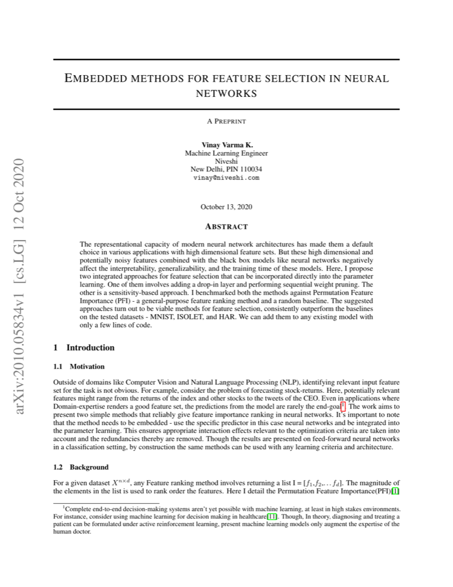

::: {.profile-page}

::: {.profile-header}
::: {.profile-identity}
# Vinay Varma

**Applied Scientist | Foundation Models**
:::

::: {.profile-links}
<a class="social-icon" href="https://github.com/vin136" aria-label="GitHub"><i class="bi bi-github"></i></a>
<a class="social-icon" href="https://www.linkedin.com/in/vinayvarma-k/" aria-label="LinkedIn"><i class="bi bi-linkedin"></i></a>
<a class="social-icon" href="https://x.com/vinnuvinay008" aria-label="X">X</a>
:::
:::

## About Me

::: {.about-grid}
::: {.portrait-wrap}
{.profile-portrait alt="Portrait of Vinay Varma"}
:::

::: {.about-copy}
I am an **Applied Scientist at Amazon Prime Video**, where I work on foundation models for recommender systems.

Previously, at **Amazon Artificial General Intelligence**, I was the research engineering lead for **Amazon Nova Multimodal Embeddings**. I built distributed training and data-loading systems, implemented core pieces of the multimodal training stack, and co-designed and trained Nova vision encoders.

Earlier, I built low-latency conversational AI systems at Vox AI and production deep reinforcement learning systems for quantitative trading at Niveshi.
:::
:::

## Experience

::: {.experience-list}
::: {.experience-item}
::: {.experience-meta}
### Amazon Prime Video
**Applied Scientist**

May 2026 - Present
:::

::: {.experience-details}
- Build foundation models for recommender systems at Prime Video.
:::
:::

::: {.experience-item}
::: {.experience-meta}
### Amazon AGI
**Applied Scientist**

August 2024 - May 2026
:::

::: {.experience-details}
- Research engineering lead for [Amazon Nova Multimodal Embeddings](https://aws.amazon.com/blogs/aws/amazon-nova-multimodal-embeddings-now-available-in-amazon-bedrock/), owning its implementation and distributed training across text, images, video, documents, and audio.
- Designed and built an elastic data loader that resumes training across changes in data parallelism and replaced the earlier training pipeline.
- Implemented model and training components across tensor parallelism, sequence parallelism, multi-objective training, and checkpoint loading for [Amazon Nova multimodal models](https://aws.amazon.com/nova/models/).
- Co-designed and trained Nova vision encoders for image and video understanding.
:::
:::

::: {.experience-item}
::: {.experience-meta}
### Vox AI
**Founding ML Engineer**

March 2024 - August 2024
:::

::: {.experience-details}
- Built low-latency conversational AI systems using fine-tuned language models, retrieval, and agentic workflows.
- Designed synthetic conversation generation and multi-round evaluation systems for tool use, long context, and regression testing.
- Optimized inference pipelines to reach human-speed conversational response times.
:::
:::

::: {.experience-item}
::: {.experience-meta}
### Charter Communications
**Data Scientist**

August 2023 - February 2024
:::

::: {.experience-details}
- Started the machine learning effort for device failure prediction on terabyte-scale operational data.
- Managed the end-to-end lifecycle across data pipelines, experimentation, deployment, and model monitoring.
:::
:::

::: {.experience-item}
::: {.experience-meta}
### Niveshi
**Machine Learning Engineer**

January 2018 - August 2021
:::

::: {.experience-details}
- Designed the deep reinforcement learning system end to end, including environments, objectives, architectures, and metrics for quantitative trading.
- Reframed the sparse reinforcement learning objective as multi-task learning to improve robustness across asset classes.
- Deployed deep ensembles for uncertainty estimation, reducing false-positive trades by 80%.
:::
:::

:::

## Selected Publications

::: {.publication-list}
::: {.publication-card}
::: {.publication-image-wrap}
{.publication-image alt="Diagram of Amazon Nova Multimodal Embeddings mapping five modalities into a unified embedding space"}
:::

::: {.publication-copy}
### Amazon Nova Multimodal Embeddings: Technical Report and Model Card

**Amazon Artificial General Intelligence** 
Amazon Technical Reports, 2025

Nova Multimodal Embeddings maps text, images, video, documents, and audio into a single embedding space for cross-modal retrieval, semantic search, and agentic RAG.

[Amazon Science](https://www.amazon.science/publications/amazon-nova-multimodal-embeddings-technical-report-and-model-card){.publication-link}
:::
:::

::: {.publication-card}
::: {.publication-image-wrap}
{.publication-image alt="Diagram of the Amazon Nova family of models"}
:::

::: {.publication-copy}
### The Amazon Nova Family of Models: Technical Report and Model Card

**Amazon Artificial General Intelligence** 
Amazon Technical Reports, 2024

The Amazon Nova family introduces multimodal and text foundation models designed for strong intelligence, speed, cost efficiency, and practical deployment on Amazon Bedrock.

[Amazon Science](https://www.amazon.science/publications/the-amazon-nova-family-of-models-technical-report-and-model-card){.publication-link}
:::
:::

::: {.publication-card}
::: {.publication-image-wrap}
{.publication-image .publication-image-paper alt="First page of Embedded Methods for Feature Selection in Neural Networks"}
:::

::: {.publication-copy}
### Embedded Methods for Feature Selection in Neural Networks

**Vinay Varma K.** 
arXiv, 2020

Introduces two feature-selection methods integrated directly into neural network training: sequential weight pruning through a drop-in layer and a sensitivity-based approach.

[arXiv](https://arxiv.org/abs/2010.05834){.publication-link}
:::
:::
:::

::: {.profile-footer}
[LinkedIn](https://www.linkedin.com/in/vinayvarma-k/) · [GitHub](https://github.com/vin136) · [Blog](posts.html)
:::

:::
